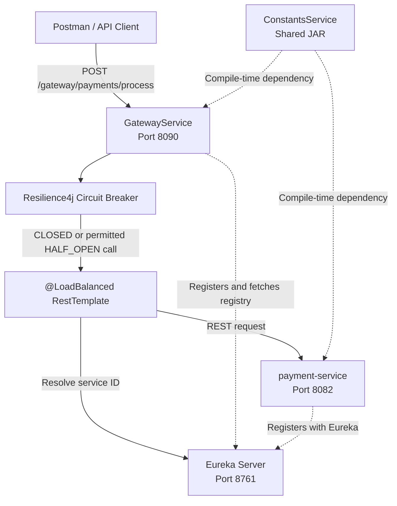
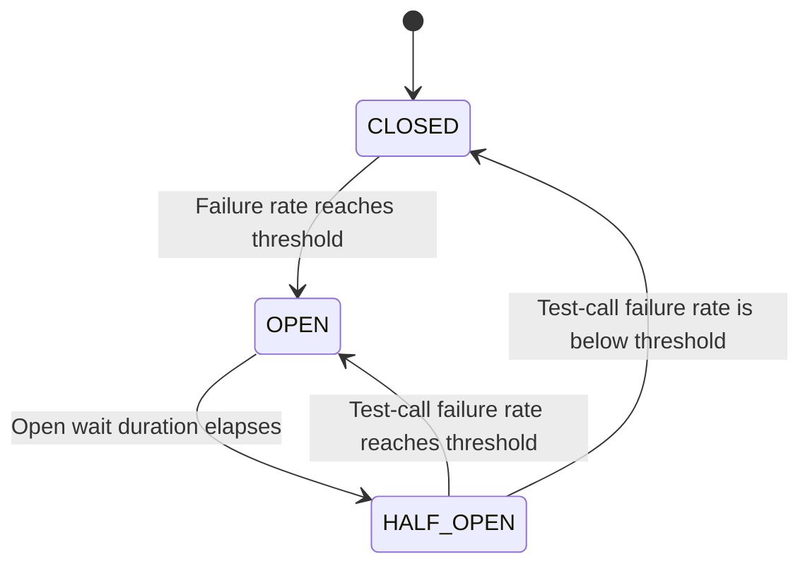

# Microservices Learning Project

A Java and Spring Boot project for learning microservices concepts by building and testing them incrementally. The current focus is service discovery, REST communication between services, a shared constants library, and fault tolerance with Resilience4j Circuit Breaker.

> **Project status:** Learning/demo project. The Payment Service uses simulated behavior; this is not a real payment-processing system.

## Contents

- [Goals](#goals)
- [Architecture](#architecture)
- [Components](#components)
- [Technology stack](#technology-stack)
- [Request flow](#request-flow)
- [Circuit Breaker configuration](#circuit-breaker-configuration)
- [Test the API](#test-the-api)
- [Run the applications](#run-the-applications)
- [Project structure](#project-structure)
- [Known demo limitations](#known-demo-limitations)
- [Future learning roadmap](#future-learning-roadmap)
- [How to keep this README updated](#how-to-keep-this-readme-updated)
- [Change log](#change-log)

## Goals

This repository is intended to demonstrate and explain microservices concepts through working examples:

- Service registration and discovery using Eureka.
- Service-to-service REST calls.
- A reusable JAR for shared constants.
- Client-side load balancing with `@LoadBalanced RestTemplate`.
- Fault tolerance using Resilience4j Circuit Breaker and a fallback method.
- Future additions documented as the project evolves.

## Architecture



### Component summary

| Component | Role | Current port / type |
|---|---|---|
| Eureka Server | Service registry used by applications to register and discover services | `8761` |
| GatewayService | Exposes the client-facing API and calls Payment Service | `8090` |
| Payment Service | Handles the demo payment request and returns a response | `8082` |
| ConstantsService | Shared JAR for constants reused by applications; it is a library, not a running service | JAR dependency |

The Gateway calls `http://payment-service/...`, not a hard-coded host and port. The `@LoadBalanced RestTemplate` resolves the service ID using the service registry.

## Technology stack

- Java 17
- Spring Boot (Gateway project currently uses Spring Boot `3.3.0`)
- Spring Cloud Netflix Eureka Client
- Spring Cloud LoadBalancer
- Spring Web / `RestTemplate`
- Resilience4j Circuit Breaker
- Maven

Confirm the actual Spring Boot and Spring Cloud versions in each module's `pom.xml` when updating this list.

## Request flow

1. The client sends a `POST` request to the Gateway on port `8090`.
2. `PaymentGatewayController` receives the request.
3. The Gateway's `PaymentService` calls the Resilience4j Circuit Breaker.
4. If the circuit permits the call, `@LoadBalanced RestTemplate` resolves `payment-service` through Eureka and sends the REST request.
5. Payment Service processes the demo request and returns `PaymentResponse`.
6. If the call fails or the circuit is OPEN, Resilience4j invokes the configured fallback method.

### Circuit Breaker states

- **CLOSED:** Calls are allowed. The Circuit Breaker records call outcomes and evaluates the failure rate after the minimum sample size is met.
- **OPEN:** Calls through this Circuit Breaker are blocked. The fallback method runs instead of sending the request to Payment Service.
- **HALF_OPEN:** After the configured OPEN duration, a limited number of test calls are permitted to check recovery. The outcomes determine whether the breaker returns to CLOSED or OPEN.



## Circuit Breaker configuration

These settings belong in **GatewayService's** `application.properties`, because the Gateway makes the remote call and is protecting itself from Payment Service failures.

```properties
# Maximum number of recent calls considered in the count-based sliding window.
# The window can contain up to 6 calls; evaluation does not need to wait for all 6.
resilience4j.circuitbreaker.instances.paymentService.slidingWindowSize=6

# Minimum number of recorded calls required before failure-rate evaluation can begin.
# Evaluation can begin after 4 calls, even if the window is not full.
resilience4j.circuitbreaker.instances.paymentService.minimumNumberOfCalls=4

# Open the circuit when the recorded failure rate reaches or exceeds 50%.
resilience4j.circuitbreaker.instances.paymentService.failureRateThreshold=50

# Keep the circuit OPEN for 10 seconds before it can transition to HALF_OPEN.
resilience4j.circuitbreaker.instances.paymentService.waitDurationInOpenState=10s

# Permit up to 4 test calls while the circuit is HALF_OPEN.
resilience4j.circuitbreaker.instances.paymentService.permittedNumberOfCallsInHalfOpenState=4

# Measure the sliding window by number of calls, rather than elapsed time.
resilience4j.circuitbreaker.instances.paymentService.slidingWindowType=COUNT_BASED
```

The instance name `paymentService` must match the annotation:

```java
@CircuitBreaker(name = "paymentService", fallbackMethod = "paymentFallback")
```

### Example of the CLOSED-state threshold

With `minimumNumberOfCalls=4` and `failureRateThreshold=50`, if 2 of the first 4 recorded calls fail, the failure rate is 50% and the circuit can open immediately. The Circuit Breaker does not have to wait for six calls. `slidingWindowSize=6` defines the maximum number of recent calls used in the count-based window; `minimumNumberOfCalls=4` defines the minimum sample size before evaluation starts.

### HALF_OPEN example

With `permittedNumberOfCallsInHalfOpenState=4`, up to four test calls can be permitted. Once the permitted calls' outcomes have been evaluated, a failure rate below 50% returns the circuit to CLOSED; a rate of 50% or higher returns it to OPEN.

## Test the API

### Endpoint

```http
POST http://localhost:8090/gateway/payments/process
Content-Type: application/json
```

### Request body

```json
{
  "fromAccount": "ACC101",
  "toAccount": "ACC202",
  "amount": 1000.0
}
```

### Successful response example

```json
{
  "transactionId": "<generated-transaction-id>",
  "status": "SUCCESS",
  "message": "Dummy payment processed successfully"
}
```

The transaction ID is generated dynamically, so its value will vary between requests.

### Demonstrate Circuit Breaker behavior

1. Start Eureka, Payment Service, and Gateway.
2. Confirm that `PAYMENT-SERVICE` and `GATEWAYSERVICE` appear as UP in the Eureka Dashboard (normally `http://localhost:8761`).
3. Send the request above to the Gateway.
4. Use the Payment Service's intentionally simulated slow/failure behavior to generate failures.
5. Send enough requests to meet the configured minimum call count and failure threshold.
6. Observe that, while the circuit is OPEN, requests use the fallback and do not reach the Payment Service through this Circuit Breaker.
7. Wait for the 10-second OPEN duration, then observe the HALF_OPEN test calls and the resulting state.

The simulated failure logic is only for learning. Make sure it is disabled or removed when you want normal successful demo requests.

## Run the applications

### Prerequisites

- JDK 17
- Maven
- An IDE such as Eclipse or IntelliJ, or a terminal

### Recommended startup order

1. Start Eureka Server on port `8761`.
2. Start Payment Service on port `8082`.
3. Start GatewayService on port `8090`.
4. Open the Eureka Dashboard and confirm both running applications are registered.
5. Send the Postman request shown in [Test the API](#test-the-api).

Use each project's own Maven command or IDE run configuration. If all modules are independent Maven projects, build/install the shared ConstantsService JAR before building applications that depend on it. If the repository is configured as a Maven multi-module project, build from the root with `mvn clean install` instead. Check the actual repository layout before choosing the command.

### Relevant properties

GatewayService:

```properties
spring.application.name=GatewayService
server.port=8090
eureka.client.service-url.defaultZone=http://localhost:8761/eureka/
eureka.client.register-with-eureka=true
eureka.client.fetch-registry=true
eureka.instance.prefer-ip-address=true
```

Payment Service:

```properties
spring.application.name=payment-service
server.port=8082
eureka.client.service-url.defaultZone=http://localhost:8761/eureka/
```

Use plain URLs in the actual `.properties` file; do not include Markdown link syntax such as `[http://localhost:8761/eureka/](http://localhost:8761/eureka/)`.

## Project structure

Adjust this example to match the actual directory names in your repository:

```text
microservices-learning/
├── README.md
├── EurekaServer/
├── GatewayService/
├── PaymentService/
└── ConstantsService/
```

If the Gateway and Payment Service use separate DTO classes with the same fields, document that choice. As the project matures, consider whether request/response DTOs belong in a dedicated shared API module rather than placing every model in the constants library.

## Known demo limitations

- Payment outcomes are simulated; there is no real ledger, database transaction, or bank integration.
- The fallback is an educational example. A fallback response such as `status=FAILED` may still be returned with HTTP `200` unless the controller explicitly maps the result to an appropriate HTTP status.
- In payment systems, a timeout or service error does not always prove that a payment failed. Production systems should distinguish failed, pending, and unknown outcomes and verify transaction status before a retry to avoid duplicate payments.
- Resilience4j's default Circuit Breaker state and counters are kept in the Gateway process memory; they are not shared across Gateway instances or persisted across restart by default.
- Eureka's registry and the Circuit Breaker's purpose are different: Eureka helps discover service instances; the Circuit Breaker helps stop repeated calls to a failing dependency.

## Future learning roadmap

Use this as a living backlog. Move a topic from **Planned** to **Implemented** only after the code and test/demo are complete.

| Topic | Status | What to document when implemented |
|---|---|---|
| Eureka service discovery | Implemented | Registration, discovery, dashboard and failure checks |
| Shared ConstantsService JAR | Implemented | Maven coordinates, build/install steps, dependency use |
| Gateway-to-Payment REST call | Implemented | Endpoint, DTO flow and load-balanced service ID |
| Resilience4j Circuit Breaker | Implemented / validating | Properties, state transitions, fallback, test evidence |
| Centralized configuration | Planned | Config source, profiles, refresh behavior |
| Retry | Planned | Which errors are retryable, retry limits, backoff; avoid unsafe payment retries |
| Time limiter / request timeout | Planned | Timeout settings and behavior |
| Bulkhead | Planned | Concurrency limits and overload behavior |
| Rate limiting | Planned | Limits, keys and expected rejection response |
| Distributed tracing and correlation IDs | Planned | Trace propagation across Gateway and Payment Service |
| Centralized logs and metrics | Planned | What to inspect and how to reproduce an alert |
| Authentication and authorization | Planned | Token validation and endpoint access rules |
| Docker / Docker Compose | Planned | Images, environment variables and startup dependencies |
| Automated tests | Planned | Unit tests, integration tests and Circuit Breaker state tests |
| CI pipeline | Planned | Build, test, package and validation steps |

Update statuses to reflect what is actually present in the codebase.

## How to keep this README updated

Whenever you add a feature, update the README in the same pull request or commit. Use this checklist:

- [ ] **Purpose:** What problem does the feature solve?
- [ ] **Architecture:** Does the architecture diagram or component table change?
- [ ] **Implementation location:** Which module and important class/configuration contain it?
- [ ] **Configuration:** Which properties, environment variables, Maven dependencies or ports are required?
- [ ] **Flow:** What happens for a normal request, failure, timeout, or unavailable dependency?
- [ ] **Run instructions:** Does the startup order or command change?
- [ ] **Example:** Add a sample request/response, command, log, or diagram where useful.
- [ ] **Verification:** Explain how someone can reproduce and confirm the feature works.
- [ ] **Limitations:** Mention demo-only behavior and important safety or reliability considerations.
- [ ] **Roadmap and change log:** Update statuses and record the change below.

### Reusable feature documentation template

Copy this section into the README when introducing a substantial feature, then replace the placeholders:

```markdown
### Feature: <feature name>

**Status:** Implemented / In progress / Planned

**Problem solved:** <What issue does this feature address?>

**Module(s):** <Which applications or libraries are involved?>

**How it works:**
1. <First step>
2. <Second step>
3. <Expected outcome>

**Configuration/dependencies:** <Properties, environment variables, Maven dependencies>

**How to test:** <Steps and sample request/response>

**Failure cases and limitations:** <What can go wrong and what is not covered>
```

## Change log

Record meaningful project changes newest-first. Keep entries short and link to a commit or issue if your repository uses them.

| Date | Change | Notes |
|---|---|---|
| 2026-10-23 | Documented current microservices setup and Circuit Breaker learning flow | Added architecture diagrams, configuration explanations, API example and ongoing documentation checklist |

---

**Documentation rule:** Keep this file aligned with the code. If a feature or configuration changes, update the corresponding section rather than letting the README describe an older implementation.
